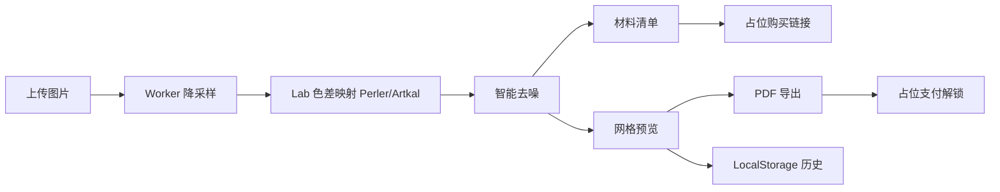

## 产品概述

基于 `beadai.docx` 从零搭建英文站点 `beadai.app`：一个免登录、全前端计算的拼豆图纸生成与材料清单工具。首版交付完整 MVP：上传图片、尺寸调节、色号映射、智能去噪、材料清单、高清图纸导出、本地历史；支付与 Amazon 联盟购买链接提供完整 UI、状态与配置入口，但使用占位/测试数据，不接入真实密钥。视觉采用“轻快手作马赛克”风格：奶油白底、糖果色豆粒、圆润卡片与拼豆网格，桌面与移动端均美观可用。

## 核心功能

- 首页/产品说明：一句话定位、四大痛点、操作流程、示例效果图墙、定价与解锁说明入口。
- 工作台：拖拽或点击上传 PNG/JPG/WEBP，限制 10MB；29x29、58x58 与自定义网格。
- 图纸生成：Lab 色差映射到 Perler/Artkal 色号，智能去噪合并孤立单像素，形成可实际摆放的色块。
- 预览与查看：马赛克网格预览、网格线/色号标注开关、悬停查看色号。
- 材料清单：总豆数、每个色号精确颗数、色卡预览、占位购买链接按钮。
- 导出与历史：高清可打印图纸导出（含小色号数字），支付占位状态控制解锁；LocalStorage 保存最近 5 张图纸。
- 支付与联盟：免登录支付 UI、状态流、配置入口与成功/失败回跳占位流程。

## 技术栈

- Next.js 15+ App Router、React 19、TypeScript（文档指定主栈）。
- Tailwind CSS + shadcn/ui 风格组件，保证留白、响应式与一致交互。
- Web Worker + HTML5 Canvas 做像素取色、映射与去噪，避免主线程卡顿。
- jsPDF 生成可打印高清图纸；LocalStorage 保存历史。
- Next.js API Route 预留支付 Webhook 与占位购买链接配置入口，部署按 Vercel 设计。

## 实现思路

采用“客户端算力为主、服务端仅保留支付回调与配置”的轻量化架构：上传图片后在 Worker 中降采样到目标网格，转换到 Lab 空间做色差匹配，再进行确定性去噪；主线程只负责渲染网格、材料清单与导出。所有商业集成通过可替换的适配层抽象，首版注入占位实现，后续替换真实 Dodo/Amazon 配置即可生效。

### 关键技术决策

- **色差算法**：预计算调色板 Lab 值，逐像素最近邻匹配；优先 CIE76，保留 CIEDE2000 接口便于切换。相比 RGB 欧氏距离更符合肉眼对塑料豆的感知。
- **性能优化**：Worker 内一次性遍历像素；去噪限制迭代轮数；大图先降采样再处理，避免 58x58 以上卡顿。
- **可替换商业层**：支付与购买链接定义为接口，首版为 Mock 实现，保证后续接入零改动 UI。
- **稳定性**：控制上传体积与图片尺寸，处理透明像素、异常图片与导出失败提示。

## 架构设计



## 目录结构

```
F:/project/beadai/
├── package.json                      # [NEW] 项目依赖与脚本
├── next.config.ts                    # [NEW] Next 配置
├── tailwind.config.ts                # [NEW] 设计 Token 与主题扩展
├── src/app/
│   ├── layout.tsx                    # [NEW] 全局布局与字体
│   ├── page.tsx                      # [NEW] 英文首页
│   ├── studio/page.tsx               # [NEW] 工作台主页面
│   ├── pricing/page.tsx              # [NEW] 定价与解锁说明
│   ├── faq/page.tsx                  # [NEW] 常见问题
│   ├── api/webhook/route.ts          # [NEW] 支付回调占位实现
├── src/components/
│   ├── ui/*                          # [NEW] 基础组件
│   ├── layout/{Header,Footer}.tsx    # [NEW] 站点导航与页脚
│   ├── studio/{UploadDropzone,GridControls,PatternCanvas,ShoppingList,ExportPanel,HistoryPanel}.tsx # [NEW] 工作台模块
│   └── marketing/{Hero,PainPoints,HowItWorks,Gallery,PricingTable,FaqList}.tsx # [NEW] 首页模块
├── src/lib/
│   ├── color/{lab.ts,palettes.ts,match.ts,denoise.ts} # [NEW] 色差映射与去噪引擎
│   ├── commerce/{payment.ts,affiliate.ts,types.ts}    # [NEW] 支付与联盟适配层
│   ├── pdf/exportPattern.ts          # [NEW] 高清图纸导出
│   ├── storage/history.ts            # [NEW] 最近 5 张图纸本地存储
│   └── utils/image.ts                # [NEW] 图片读取与体积校验
├── src/workers/pattern.worker.ts     # [NEW] 后台生成图纸
└── src/types/pattern.ts              # [NEW] 图纸与色号类型定义
```

## 关键代码结构

- `src/types/pattern.ts`：定义 `PatternResult`、`PaletteColor`、`BeadUsage`、`PatternSettings`。
- `src/lib/commerce/types.ts`：定义支付与购买链接适配接口（`createCheckout`、`getPurchaseUrl`）。
- `src/workers/pattern.worker.ts`：定义 worker 消息契约（`generate`、`progress`、`done`、`error`）。

## 实施注意点

- 复用 Tailwind 设计 Token，避免散落硬编码颜色。
- Worker 消息需带 requestId，避免快速切换尺寸时的竞态结果覆盖。
- 大图先降采样，58x58 以上需显示进度与超时保护。
- 历史记录仅存缩略图与必要参数，避免 LocalStorage 超限。
- 所有商业链接走适配层，禁止在组件内硬编码第三方地址。

## 设计方向

轻快手作马赛克：奶油白底、糖果色豆粒、圆润卡片与真实拼豆网格质感。首页用大号标题与马赛克拼豆示例墙建立第一印象，工作台采用左右分栏，桌面并排展示原图、图纸预览与材料清单，移动端改为纵向堆叠与底部固定操作条。交互强调“放置豆子”的手作感：卡片轻微上浮、豆粒悬停放大与色号提示、网格逐格渲染动画。整站保持大留白、清晰层级和彩色点缀。

## 页面与区块

- 首页：导航栏、Hero（标题+上传入口+示例图）、痛点四宫格、操作流程三步、作品马赛克墙、定价入口、FAQ 精简区、页脚。
- 工作台：顶部步骤条，左侧上传与尺寸/去噪/显示控制，中部图纸预览与悬停详情，右侧材料清单与购买链接，底部导出与历史面板。
- 定价页：Hero、免费与付费对比表、支付占位流程说明、FAQ 关联入口、页脚。
- FAQ 页：搜索框、折叠问答列表、联系/反馈入口、页脚。

## 视觉细节

- 卡片：大圆角、柔和阴影、细边框。
- 豆粒：圆形高光渐变，网格线可切换。
- 动效：按钮微交互、上传成功弹跳、图纸逐格渐显、清单数字滚动。
- 响应式：桌面三栏、平板两栏、移动单栏加底部操作条。

## Agent Extensions

### Skill

- **docx**
- 用途：已用于读取并解析 `beadai.docx` 的商业计划、PRD 与技术方案。
- 预期结果：完整提取产品定位、功能清单、技术栈与算法要求，作为站点设计与实现依据。