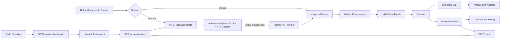

## 产品概述

基于 `beadai.docx` 从零搭建英文站点 `beadai.app`：一个免登录、客户端计算为主的拼豆（Fuse Beads / Perler）图纸生成与材料清单工具，并新增“AI 灵感生成器”（Text-to-Pixel Art）。首版交付完整 MVP：图片上传、AI 文生像素图、尺寸调节、Lab 色号映射、智能去噪、材料清单、高清图纸导出、本地历史；支付改为接真实 Dodo Payments 订阅权益；Amazon 联盟购买链接保留适配层与配置入口（暂无联盟凭据）。

## 核心功能

- **工作台双入口**：上传 PNG/JPG/WEBP（≤10MB，拖拽或点击）与 AI Prompt 输入二选一；AI 生成图自动流入同一套 Canvas 降采样与色号映射链路。
- **AI 灵感生成器**：英文 Prompt 输入框、示例 Prompt、每日剩余额度展示、生成进度、失败重试、生成后一键“转成拼豆图纸”。
- **图纸生成**：29x29（标准单板）、58x58（四板拼接）与自定义网格；Lab 色差映射到 Perler / Artkal 官方色号；智能去噪合并孤立单像素成可摆放色块。
- **预览与查看**：马赛克拼豆网格预览、网格线与色号标注开关、悬停放大并显示色号。
- **材料清单**：总豆数、每个色号精确颗数、色卡预览、可配置购买链接按钮。
- **导出与历史**：含微小色号数字的高清可打印 PDF（订阅权益解锁）；LocalStorage 保存最近 5 张图纸。
- **订阅与额度**：真实 Dodo Payments 订阅（无限 AI 生成 + 58x58 + PDF 导出）；游客由服务端强制限制每天 3 次 AI 生成；免登录权益恢复与管理入口。
- **站点页面**：首页营销、工作台、定价订阅、权益恢复/管理、常见问题，全站英文、桌面与移动端响应式。

## 需要你补充的信息

- Together AI API Key 与所选像素模型标识（如 Flux-Schnell / SDXL-PixelArt 在 Together 上的准确模型名）。
- Upstash Redis REST URL 与 Token（用于每日 3 次额度与订阅权益持久化）。
- Dodo Payments：API Key、Webhook Secret、产品/价格 ID、是否提供 Customer Portal（用于续费/取消）。
- Amazon Associates 联盟 Tag 与按色号的购买链接规则（未提供前走配置化占位，不写死第三方地址）。
- 品牌资产：域名（默认 beadai.app）、Logo、示例作品图；Perler / Artkal 官方色号表的准确来源（决定色号映射质量）。

## 边界说明

- 不在首版做注册登录、后端数据库存储用户图纸、3D 立体图纸拼接。
- 缺凭据时不得构建失败：提供 `.env.example`、配置校验与明确的 disabled/development 状态提示。
- 营销文案避免无法核验的承诺（不宣传模型质量、不宣传精确的单张生成成本），离线色号匹配算法不称为 AI。

## 技术栈

- **框架**：Next.js 15（App Router）+ React 19 + TypeScript 5。文档指定该栈，且 AI 生成、额度、支付回调必须走服务端路由才能保护密钥，因此不采用纯前端 Vite SPA 方案。
- **样式与组件**：Tailwind CSS 3.4.17 + tailwindcss-animate + tailwind-merge，shadcn/ui 风格组件，lucide-react / react-icons 图标。
- **核心计算**：Web Worker + OffscreenCanvas / createImageBitmap，主线程零阻塞。
- **服务端**：Next.js Route Handlers；Upstash Redis（@upstash/redis）做额度与权益持久化；Dodo Payments 做真实订阅与 Webhook；Together AI 做图像生成（Provider 可替换）。
- **其他**：jsPDF 生成矢量高清图纸；framer-motion 做微动效；zod 或轻量手写校验做入参与环境校验；部署按 Vercel 设计。

## 实现思路

采用“客户端算力为主、服务端只做密钥保护与商业闭环”的架构：图片或 AI 生成图统一进入 Worker 做降采样 → Lab 最近邻映射 → 确定性去噪；服务端仅负责 AI 生成代理、匿名额度、订阅权益与配置。所有外部商业与 AI 能力都定义为可替换 Provider 接口，UI 不感知具体实现。

### 关键技术决策

- **色差算法**：启动时预计算调色板 Lab 值，逐像素最近邻匹配；默认 CIE76（快、稳定），保留 CIEDE2000 开关接口。较 RGB 欧氏距离更贴合肉眼对塑料豆的感知。
- **去噪**：确定性迭代合并孤立像素（按 4/8 邻域主色替换），限制迭代轮数与最小连通块阈值，保证同一输入结果可复现。
- **性能**：58x58 仅 3364 格，Worker 单次遍历完成；大图先降采样再处理，避免逐原图像素匹配；AI 路由设置超时、并发与返回体积上限。
- **安全**：Together Key 仅服务端使用；匿名额度靠 HttpOnly 签名 Cookie + IP 信号 + Redis 原子计数，绝不信客户端 LocalStorage；Webhook 验签 + 幂等；权益一律服务端校验后下发。
- **无登录权益闭环**：下单时把匿名 ID 写入 Dodo metadata；Webhook 按 `subscription` 与 `customer email` 落库；支付返回页轮询权益状态；另提供邮箱找回的一次性恢复链接与 Customer Portal 管理续费/取消。

## 架构设计



## 实施注意点

- Worker 消息带 `requestId`，快速切换尺寸时丢弃过期结果，避免竞态覆盖。
- 调色板 Lab 只计算一次并缓存；历史记录只存缩略图与参数，避免 LocalStorage 超限。
- AI 路由校验 Prompt 长度、返回内容类型与体积；上游失败返回可操作错误（超时、限流、内容拦截）。
- 所有第三方地址与密钥走配置层，禁止组件内硬编码；日志不记录密钥、邮箱明文与 Prompt 全文。
- 进度与失败态需在 UI 可见（额度用尽、生成失败、支付待确认），并支持重试。

## 目录结构

```
F:/project/beadai/
├── package.json                      # [NEW] 依赖与脚本，锁定 Next 15 / React 19 / TS 5 / Tailwind 3.4.17
├── next.config.mjs                   # [NEW] Next 配置（图片与构建优化）
├── tailwind.config.ts                # [NEW] 设计令牌：奶油白、糖果色、圆角与阴影、动效
├── postcss.config.mjs                # [NEW] tailwindcss + autoprefixer
├── tsconfig.json                     # [NEW] 路径别名 @/*
├── .env.example                      # [NEW] Together / Upstash / Dodo / 联盟配置示例
├── README.md                         # [NEW] 本地启动、环境变量与部署说明
├── src/app/
│   ├── layout.tsx                    # [NEW] 全局布局、Poppins 字体、Header/Footer
│   ├── globals.css                   # [NEW] Tailwind 基础层与全局变量
│   ├── page.tsx                      # [NEW] 英文首页（Hero/痛点/流程/AI 展示/作品墙/定价/FAQ）
│   ├── studio/page.tsx               # [NEW] 工作台，组合上传、AI 生成、预览、清单、导出、历史
│   ├── pricing/page.tsx              # [NEW] 定价对比、Checkout 入口、权益状态
│   ├── access/page.tsx               # [NEW] 免登录权益恢复、管理订阅、支付返回状态
│   ├── faq/page.tsx                  # [NEW] 搜索与折叠问答
│   └── api/
│       ├── ai/generate/route.ts      # [NEW] 服务端生成：校验、额度、限流、调用 Provider、回传图片
│       ├── checkout/route.ts         # [NEW] 创建 Dodo 订阅结账并写入匿名 ID
│       ├── webhook/dodo/route.ts     # [NEW] 验签、幂等、写入/更新订阅权益
│       ├── entitlement/route.ts      # [NEW] 服务端校验并返回当前权益与 AI 剩余额度
│       └── access/restore/route.ts   # [NEW] 邮箱找回一次性恢复链接
├── src/components/
│   ├── ui/*                          # [NEW] shadcn 风格基础组件（Button/Card/Slider/Tabs/Dialog/Badge/Input/Accordion/Toast/Tooltip）
│   ├── layout/{SiteHeader,SiteFooter,StickyActionBar}.tsx  # [NEW] 固定顶栏、页脚、移动端底部操作条
│   ├── marketing/{Hero,PainPoints,HowItWorks,AIShowcase,GalleryWall,PricingTable,FaqList,FinalCta}.tsx # [NEW] 首页与营销区块
│   └── studio/{SourceSwitch,UploadDropzone,AIPromptPanel,QuotaBadge,GridControls,PatternCanvas,ShoppingList,ExportPanel,HistoryPanel,EntitlementCard}.tsx # [NEW] 工作台模块
├── src/lib/
│   ├── env.ts                        # [NEW] 环境变量校验与功能开关（ai/payments/affiliate）
│   ├── redis.ts                      # [NEW] Upstash Redis 单例与键前缀
│   ├── color/{lab.ts,palettes.ts,match.ts,denoise.ts} # [NEW] sRGB→Lab、色号表、最近邻映射、确定性去噪
│   ├── pattern/{downsample.ts,generate.ts}            # [NEW] 降采样与图纸生成编排
│   ├── ai/{types.ts,together.ts,provider.ts,prompt.ts} # [NEW] Provider 抽象、Together 实现、Prompt 文案与安全校验
│   ├── quota/{anonymous.ts,aiQuota.ts}                # [NEW] 签名匿名 Cookie、每日 3 次原子计数
│   ├── entitlement/{dodo.ts,entitlement.ts,session.ts} # [NEW] 订阅落库、权益判定、签名会话
│   ├── commerce/affiliate.ts         # [NEW] 购买链接构建与配置化回退
│   ├── pdf/exportPattern.ts          # [NEW] jsPDF 矢量高清图纸与色号标注
│   ├── storage/history.ts            # [NEW] 最近 5 张图纸本地存储
│   └── utils/{image.ts,cn.ts}        # [NEW] 图片读取、体积校验与类名合并
├── src/hooks/{usePatternWorker.ts,useEntitlement.ts,useHistory.ts} # [NEW] Worker 通信、权益与历史 Hook
├── src/workers/pattern.worker.ts     # [NEW] 后台生成图纸消息契约
└── src/types/{pattern.ts,ai.ts,entitlement.ts} # [NEW] 图纸、AI 与权益类型
```

## 关键代码结构

- `src/types/pattern.ts`：图纸与调色板核心类型。

```ts
export interface PaletteColor { id: string; code: string; name: string; rgb: [number, number, number]; brand: 'perler' | 'artkal' }
export interface PatternSettings { width: number; height: number; brand: 'perler' | 'artkal'; denoise: boolean; denoiseLevel: number }
export interface BeadUsage { color: PaletteColor; count: number }
export interface PatternResult { width: number; height: number; cells: number[]; usage: BeadUsage[]; totalBeads: number; thumbnail: string }
```

- `src/lib/ai/types.ts`：图像生成 Provider 抽象，便于从 Together AI 切换到 Replicate。

```ts
export interface GeneratedImage { dataUrl: string; width: number; height: number; model: string; provider: string }
export interface ImageProvider { readonly name: string; generate(prompt: string, opts: { signal?: AbortSignal }): Promise<GeneratedImage> }
```

- `src/lib/entitlement/entitlement.ts`：权益判定接口，服务端统一裁决无限生成与导出解锁。

```ts
export interface EntitlementStatus { active: boolean; plan: 'free' | 'pro'; aiRemaining: number | null; aiUnlimited: boolean; canExportPdf: boolean; maxGrid: number; renewsAt?: string; source: 'anonymous' | 'subscription' }
export interface EntitlementStore { get(subjectKey: string): Promise<EntitlementStatus | null>; upsertFromWebhook(event: unknown): Promise<void> }
```

## 设计风格

轻快手作马赛克：奶油白底、糖果色豆粒、圆润卡片与真实拼豆网格质感。整站用 Poppins 建立友好而现代的英文排版层级，按钮与卡片带轻微上浮阴影，豆粒使用圆形高光渐变，配合逐格渐显与悬停放大等微动效。AI 能力作为亮点呈现：Prompt 卡片带渐变描边与光晕，但不使用夸张的“魔法”承诺文案。桌面三栏工作台、平板两栏、移动端纵向堆叠加底部固定操作条，导航顶部固定并为内容预留安全间距。

## 页面与区块

### 1. 首页 Home

- **顶部导航栏（固定）**：拼豆马赛克 Logo、Home/Studio/Pricing/FAQ 链接、右侧每日额度徽标与 Go to Studio 主按钮。
- **Hero 主视觉**：大标题“Turn any photo or idea into a real bead pattern”，双入口按钮（Upload a photo / Describe with AI），右侧马赛克示例拼豆图，底部 no sign-up 信任条。
- **AI 灵感展示区**：示例 Prompt chips、三步链路图（Prompt → Pixel art → Bead pattern）、免费额度与订阅解锁说明。
- **痛点四宫格**：大图难转、杂色过多、色号难配、算税繁琐，四张糖果色圆角卡片配图标。
- **操作流程三步**：上传或描述、自动映射去噪、导出图纸与购物清单，配编号圆点与连接线。
- **作品马赛克墙**：网格化示例作品，悬停放大并显示尺寸与色数。
- **定价入口条与 FAQ 精简区**：免费/Pro 对比摘要与 CTA，三条高频问答，底部完整页脚。

### 2. 工作台 Studio

- **顶部导航与步骤条**：固定导航，下方三步进度指示（Source → Pattern → Export）。
- **来源切换器**：Upload photo 与 AI prompt 的胶囊式切换，带微动效指示。
- **上传 / AI 生成面板**：拖拽上传区（拖拽高亮、格式与 10MB 校验）；AI 面板含 Prompt 输入框、示例 chips、额度徽标、生成进度与重试。
- **图纸预览画布**：马赛克拼豆网格，豆粒圆形高光，网格线与色号标注开关，悬停显示色号与品牌。
- **控制面板**：29x29 / 58x58 / 自定义滑块、品牌色库切换、去噪强度，订阅权益控制解锁。
- **材料清单**：总豆数、每色号颗数与色卡，购买链接按钮，数字滚动动效。
- **导出与历史面板**：PDF 导出按钮（未解锁显示权益卡），最近 5 张图纸缩略图历史，移动端底部固定操作条。

### 3. 定价 Pricing

- **顶部导航**：与其他页面一致的固定导航。
- **定价 Hero**：标题与副标题说明免费预览与 Pro 解锁边界。
- **对比表**：29x29、AI 生成 3 次/天 vs 无限、58x58、PDF 导出、购物清单，逐项对比与推荐标记。
- **Checkout 权益卡**：当前状态、Dodo 结账按钮、已订阅用户的管理与恢复入口。
- **FAQ 关联与页脚**：与支付、额度、导出相关的问答摘要与完整页脚。

### 4. 权益恢复 Access

- **顶部导航**：统一固定导航。
- **恢复表单**：输入购买邮箱获取一次性恢复链接，说明免登录场景下的使用方式。
- **当前权益卡**：显示计划状态、AI 额度、续费日期，提供 Customer Portal 管理与取消。
- **支付返回状态区**：成功、处理中与失败的明确状态提示与后续动作。
- **帮助与页脚**：联系/反馈入口与完整页脚链接。

### 5. 常见问题 FAQ

- **顶部导航与搜索框**：固定导航，下方大搜索框实时过滤问答。
- **分类标签**：Generation、Patterns、Pricing、Export 等分类切换。
- **折叠问答列表**：手风琴展开，包含 AI 额度、色号匹配、导出打印、订阅与退款。
- **联系与页脚**：反馈入口与完整页脚。

## 响应式与交互

桌面以三栏工作台与宽幅营销栅格为主；平板降为两栏；移动端纵向堆叠，核心操作固定底部。所有交互元素具备 hover、active、focus 状态与合理光标，卡片轻微上浮，豆粒悬停放大，图纸逐格渐显，清单数字滚动。