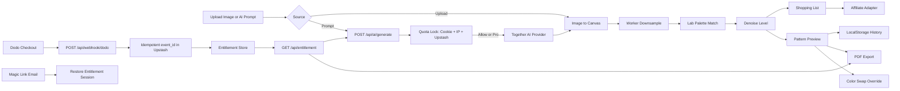

## 产品概述

基于 `beadai.docx` 在空目录 `F:/project/beadai` 从零搭建英文站点 `beadai.app`：一个免登录、客户端计算为主的拼豆（Fuse Beads / Perler / Artkal）图纸生成与材料清单工具，并新增「AI 灵感生成器」（Text-to-Pixel Art）。首版交付完整 MVP，并落地用户追加的四类细节优化：色号替换与去噪调节、AI 防刷与 Prompt 安全、Dodo Webhook 幂等与支付轮询、邮件 Magic Link 恢复与新手尺寸指引。

## 核心功能

- **工作台双入口**：拖拽上传 PNG/JPG/WEBP（≤10MB）或输入英文 Prompt；AI 生成图自动流入同一套 Canvas 降采样与色号映射链路。
- **AI 灵感生成器**：Prompt 输入框、示例 chips、每日剩余额度、生成进度、失败重试、冷却与禁用态、安全拦截提示、生成后一键转成拼豆图纸。
- **图纸生成**：29×29 / 58×58 / 自定义网格；Lab 色差映射到 Perler / Artkal 官方色号；去噪强度多档（Off / Light / Balanced / Strong）可实时预览。
- **色号替换 Color Swap**：点击图纸颜色或清单色行选中源色，按 Lab 距离推荐相近色号，预览名称/色号/RGB/用量变化，支持撤销与重置并实时重算材料清单。
- **预览与查看**：马赛克拼豆网格、网格线与色号标注开关、悬停放大显示色号与品牌、逐格渐显动效。
- **材料清单**：总豆数、每色号精确颗数、色卡预览、可配置购买链接按钮。
- **导出与历史**：含微小色号数字的高清可打印 PDF（Pro 解锁）；LocalStorage 保存最近 5 张图纸。
- **订阅与额度**：真实 Dodo Payments 订阅解锁无限 AI 生成、58×58 与 PDF 导出；游客服务端强制 3 次/天；支付返回页轮询权益；邮箱一次性 Magic Link 恢复与管理订阅。
- **站点页面**：首页营销、工作台、定价订阅、权益恢复、常见问题；英文 SEO 元数据、sitemap、robots、FAQ 结构化数据（仅真实内容）。
- **新手引导**：尺寸选择旁展示直观说明，如「29×29 — Great for beginners; fits one standard pegboard.」「58×58 — More detail; requires four standard pegboards.」，自定义尺寸显示预估板数与豆数。

## 边界说明

- 不做注册登录、云端图纸存储、3D 立体图纸拼接。
- 缺凭据时不得构建失败：提供 `.env.example`、配置校验与明确的 disabled / development 状态提示。
- 营销文案避免无法核验承诺：不宣传精确单张生成成本，不把离线确定性色号匹配称为 AI。
- 版权与 NSFW：仅做关键词黑名单基础拦截与提示，不宣称能可靠判定版权归属。

## 技术栈

- **框架**：Next.js 15（App Router）+ React 19 + TypeScript 5。AI 生成、额度、支付回调、邮件恢复必须走服务端路由保护密钥，因此不采用纯前端 SPA。
- **样式与组件**：Tailwind CSS 3.4.17 + tailwindcss-animate + tailwind-merge，shadcn/ui 风格组件，lucide-react / react-icons 图标，framer-motion 微动效。
- **核心计算**：Web Worker + OffscreenCanvas / createImageBitmap，主线程零阻塞；jsPDF 生成矢量高清图纸。
- **服务端与集成**：Next.js Route Handlers；Upstash Redis（`@upstash/redis`）做每日额度、幂等、权益与一次性令牌存储；Together AI 图像生成（Provider 可替换）；Dodo Payments 订阅与 Webhook；Resend 发送 Magic Link 邮件（适配器可替换）。
- **校验与工具**：轻量 zod 校验入参与环境变量，Poppins 字体，Vercel 部署设计。
- **实现期必备动作**：使用 [skill:dodo-google-credits] 获取并遵循 Standard Webhooks 验签、订阅额度发放、账本幂等与常见踩坑；使用 [skill:多模态内容生成] 生成首页示例拼豆效果图与作品墙素材；使用 [skill:docx] 复核原始需求文档的 PRD 细节。

## 实现思路

采用「客户端算力为主、服务端只做密钥保护与商业闭环」的架构：图片或 AI 生成图统一进入 Worker 做降采样 → Lab 最近邻映射 → 确定性去噪 → 色号替换叠加层；服务端仅负责 AI 代理、匿名额度、订阅权益、邮件恢复与配置。所有外部能力都定义为可替换 Provider 接口，UI 不感知具体实现。

### 关键技术决策

- **色差算法**：启动预计算调色板 Lab 值并缓存，逐像素最近邻匹配；默认 CIE76，保留 CIEDE2000 接口。较 RGB 欧氏距离更贴合肉眼对塑料豆的感知。
- **去噪**：确定性迭代合并孤立像素（4/8 邻域主色替换 + 最小连通块阈值），限制迭代轮数，保证同输入结果可复现；Off/Light/Balanced/Strong 映射到不同阈值，防抖再生。
- **色号替换**：保留 `basePattern` 与 `overrideMap` 两层数据，替换只改映射叠加层，改尺寸/去噪时重新生成基础图纸并尽力保留覆盖，避免破坏可复现性。
- **性能**：58×58 仅 3364 格，Worker 单次遍历完成；大图先降采样再处理；AI 路由设置超时、并发锁、返回体积上限与缓存缩略图。
- **安全**：Together / Dodo / Resend 密钥仅服务端；匿名额度靠 HttpOnly 签名 Cookie + IP 信号 + Redis 原子计数，不信客户端 LocalStorage；前端仅做冷却与禁用，真正防线在服务端。
- **幂等与权益**：Webhook 原始体验签，先用 Redis 原子 `SET NX` 抢占 `event_id`，处理成功再标记完成；失败可安全重试。支付返回页受限时间轮询 `/api/entitlement`，绝不把权益写进 URL。

## 架构设计



## 目录结构

```
F:/project/beadai/
├── package.json                      # [NEW] 依赖与脚本，锁定 Next 15 / React 19 / TS 5 / Tailwind 3.4.17
├── next.config.mjs                   # [NEW] Next 配置与图片优化
├── tailwind.config.ts                # [NEW] 设计令牌：奶油白、糖果色、圆角、阴影、动效
├── postcss.config.mjs                # [NEW] tailwindcss + autoprefixer
├── tsconfig.json                     # [NEW] 路径别名 @/*，verbatimModuleSyntax=false
├── .env.example                      # [NEW] Together / Upstash / Dodo / Resend / 联盟配置示例
├── README.md                         # [NEW] 启动、环境变量、Webhook 与部署说明
├── src/app/
│   ├── layout.tsx                    # [NEW] 全局布局、Poppins、Header/Footer、SEO 元数据
│   ├── globals.css                   # [NEW] Tailwind 基础层与全局变量
│   ├── page.tsx                      # [NEW] 首页：Hero/痛点/流程/AI 展示/作品墙/定价/FAQ
│   ├── studio/page.tsx               # [NEW] 工作台：上传、AI、预览、清单、导出、历史
│   ├── pricing/page.tsx              # [NEW] 定价对比、Checkout 入口、权益状态
│   ├── access/page.tsx               # [NEW] 支付返回轮询、邮箱恢复、订阅管理
│   ├── faq/page.tsx                  # [NEW] 搜索与分类折叠问答
│   ├── sitemap.ts / robots.ts        # [NEW] SEO 站点地图与抓取规则
│   └── api/
│       ├── ai/generate/route.ts      # [NEW] 校验、并发锁、额度、安全过滤、调用 Provider
│       ├── checkout/route.ts         # [NEW] 创建 Dodo 订阅结账并写入匿名 ID
│       ├── webhook/dodo/route.ts     # [NEW] 原始体验签 + event_id 幂等 + 权益更新
│       ├── entitlement/route.ts      # [NEW] 服务端裁决权益与 AI 剩余额度
│       ├── access/restore/route.ts   # [NEW] 邮箱一次性 Magic Link 请求（限流）
│       └── access/claim/route.ts     # [NEW] 校验并消费 Magic Link，下发签名权益会话
├── src/components/
│   ├── ui/*                          # [NEW] shadcn 风格 Button/Card/Slider/Tabs/Dialog/Badge/Input/Accordion/Toast/Tooltip
│   ├── layout/{SiteHeader,SiteFooter,StickyActionBar}.tsx  # [NEW] 固定顶栏、页脚、移动端底部操作条
│   ├── marketing/{Hero,PainPoints,HowItWorks,AIShowcase,GalleryWall,PricingTable,FaqList,FinalCta}.tsx # [NEW] 首页与营销区块
│   └── studio/{SourceSwitch,UploadDropzone,AIPromptPanel,QuotaBadge,GridControls,PatternCanvas,ColorSwapPanel,ShoppingList,ExportPanel,HistoryPanel,EntitlementCard}.tsx # [NEW] 工作台模块
├── src/lib/
│   ├── env.ts                        # [NEW] 环境变量校验与 ai/payments/email/affiliate 功能开关
│   ├── redis.ts                      # [NEW] Upstash Redis 单例与键前缀
│   ├── color/{lab.ts,palettes.ts,match.ts,denoise.ts,swap.ts} # [NEW] Lab 转换、色号表、最近邻、去噪、替换
│   ├── pattern/{downsample.ts,generate.ts}            # [NEW] 降采样与图纸生成编排
│   ├── ai/{types.ts,together.ts,provider.ts,prompt.ts,safety.ts} # [NEW] Provider 抽象、Together 实现、Prompt 处理与安全拦截
│   ├── quota/{anonymous.ts,aiQuota.ts}                # [NEW] 签名匿名 Cookie、每日 3 次原子计数与并发锁
│   ├── entitlement/{dodo.ts,entitlement.ts,session.ts} # [NEW] 订阅落库、权益判定、签名会话
│   ├── email/{types.ts,resend.ts,templates.ts}        # [NEW] 邮件适配器与 Magic Link 模板
│   ├── commerce/affiliate.ts         # [NEW] 购买链接构建与配置化回退
│   ├── pdf/exportPattern.ts          # [NEW] jsPDF 矢量高清图纸与色号标注
│   ├── storage/history.ts            # [NEW] 最近 5 张图纸本地存储
│   └── utils/{image.ts,cn.ts}        # [NEW] 图片读取、体积校验与类名合并
├── src/hooks/{usePatternWorker.ts,useEntitlementPolling.ts,useHistory.ts} # [NEW] Worker 通信、权益轮询、历史
├── src/workers/pattern.worker.ts     # [NEW] 后台生成图纸消息契约（requestId 防竞态）
└── src/types/{pattern.ts,ai.ts,entitlement.ts} # [NEW] 图纸、AI 与权益类型
```

## 关键代码结构

- `src/types/pattern.ts`：图纸、覆盖层与材料统计核心类型。

```ts
export interface PaletteColor { id: string; code: string; name: string; rgb: [number, number, number]; brand: 'perler' | 'artkal' }
export interface PatternSettings { width: number; height: number; brand: 'perler' | 'artkal'; denoiseLevel: 0 | 1 | 2 | 3 }
export interface PatternResult { width: number; height: number; cells: number[]; usage: BeadUsage[]; totalBeads: number; thumbnail: string }
export interface PatternSwapMap { [fromColorId: string]: string }
```

- `src/lib/entitlement/entitlement.ts`：权益统一裁决接口。

```ts
export interface EntitlementStatus {
  active: boolean
  plan: 'free' | 'pro'
  aiRemaining: number | null
  aiUnlimited: boolean
  canExportPdf: boolean
  maxGrid: number
  renewsAt?: string
  source: 'anonymous' | 'subscription'
}
export interface EntitlementStore {
  get(subjectKey: string): Promise<EntitlementStatus | null>
  upsertFromWebhook(event: unknown): Promise<void>
}
```

## 实施注意点

- Worker 消息带 `requestId`，快速切换尺寸/去噪时丢弃过期结果。
- 去噪与尺寸变更需防抖，Color Swap 只更新叠加层，不重复跑重算法。
- AI 按钮：请求中禁用 + 完成后短冷却 + AbortController + 单飞；服务端另有 Redis 并发锁与幂等键，前端只是体验层。
- Prompt：服务端归一化与长度校验、关键词黑名单、Provider 安全响应作为第二层，错误映射为稳定 code 与友好英文提示；日志不记录 Prompt 全文、邮箱明文与密钥。
- Webhook：先原子抢占 `event_id` 再处理，成功写 completed 与 TTL；已处理事件直接返回成功；退款/取消/过期需按实际事件幂等撤销权益。
- 邮件恢复：短时单次不透明令牌哈希存储、防邮件枚举的统一响应、IP/邮箱限流与重发冷却；域名与发件地址未验证时显示 disabled 状态。
- 历史记录只存缩略图与参数；PDF 导出前校验权益；所有第三方地址与密钥走配置层。

## 设计风格

轻快手作马赛克：奶油白底、糖果色豆粒、真实拼豆网格质感与圆润卡片。整站以 Poppins 建立友好现代的英文排版层级，卡片大圆角与柔和上浮阴影，豆粒使用圆形高光渐变，配合逐格渐显、悬停放大、清单数字滚动等微动效。首页用大标题与马赛克示例墙建立第一印象，AI 区块用渐变描边与柔光呈现科技感但不做魔法承诺。桌面三栏工作台、平板两栏、移动端纵向堆叠加底部固定操作条，导航顶部固定并为内容预留安全间距，全站大留白、清晰层级与彩色点缀。

## 页面与区块

- 首页：固定导航（Logo/Home/Studio/Pricing/FAQ + 额度徽标 + Go to Studio）；Hero 大标题与双入口；AI 灵感展示（示例 chips、Prompt→Pixel→Bead 三步链路、额度说明）；痛点四宫格；操作流程三步；作品马赛克墙；定价入口条；FAQ 精简区；完整页脚。
- 工作台：步骤条 Source→Pattern→Export；来源切换胶囊；拖拽上传区与 AI Prompt 面板（示例 chips、额度、进度、重试、冷却）；图纸预览画布（网格线/色号标注开关、悬停色号）；控制面板（尺寸卡片带新手文案、品牌色库、去噪档位）；色号替换面板；材料清单；导出与最近 5 张历史；移动端底部操作条。
- 定价：Hero 与免费/Pro 边界说明；逐项对比表与推荐标记；Checkout 权益卡与已订阅管理入口；支付与额度 FAQ；完整页脚。
- 权益恢复：恢复表单、当前权益卡、支付返回状态区（Processing / Pro active / 延迟需刷新 / 失败）、Customer Portal 管理与取消、帮助与页脚。
- FAQ：固定导航与实时搜索框；Generation/Patterns/Pricing/Export 分类标签；手风琴问答；联系与页脚。

## 响应式与交互

桌面三栏工作台与宽幅营销栅格；平板两栏；移动端单栏并固定底部核心操作。所有交互元素具备 hover、active、focus 状态与合理光标，禁用态显示 `not-allowed`，加载态有明确进度与可取消操作。

## Agent Extensions

### Skill

- **dodo-google-credits**
- 用途：实现 Dodo Payments 订阅结账、Standard Webhooks 验签、event_id 幂等、订阅额度发放、续订/取消/退款处理与支付返回轮询。
- 预期结果：按真实踩坑经验完成安全可靠的付费闭环，避免重复计权益、验签失败与支付后状态不同步。
- **多模态内容生成**
- 用途：生成首页 Hero、AI 展示区与作品墙所需的拼豆效果图与示例素材，保证视觉丰富且风格统一。
- 预期结果：得到马赛克拼豆风格的高质量示例图，提升首屏吸引力与作品墙完整度。
- **docx**
- 用途：复核 `beadai.docx` 中的 PRD、技术选型与算法要求，确保实现与原始文档一致。
- 预期结果：完整覆盖文档中的功能、算法与商业闭环要求。