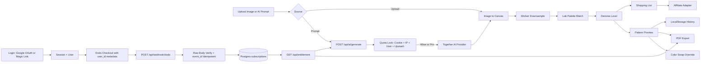

## 产品概述

基于 `beadai.docx` 在空目录 `F:/project/beadai` 从零搭建英文站点 `beadai.app` 完整 MVP：一个“免登录即可试用、登录后获得长期权益”的拼豆（Fuse Beads / Perler / Artkal）图纸生成工具，并新增「AI 灵感生成器」（Text-to-Pixel Art）。

视觉采用轻快手作马赛克风格：奶油白底、糖果色豆粒、圆润卡片、真实拼豆网格质感、Poppins 排版和细腻微动效，桌面与移动端均需美观可用。

账户体系采用渐进式登录：本地图片转换和 29×29 图纸完全免登录；游客每天可使用 3 次 AI 生成；订阅、无限 AI、权益恢复与跨设备恢复时必须登录。首版登录方式为 Google OAuth 与 Resend 邮箱 Magic Link，均不使用密码。

## 核心功能

- **工作台双入口**：拖拽或点击上传 PNG/JPG/WEBP（≤10MB），或输入英文 Prompt 生成像素风图片；AI 生成图自动流入同一套 Canvas 降采样与色号映射链路。
- **AI 灵感生成器**：Prompt 输入框、示例 Prompt chips、每日剩余额度、生成进度、失败重试、冷却与禁用态、安全拦截友好提示、生成后一键“转成拼豆图纸”。
- **图纸生成**：29×29、58×58 与自定义网格；Lab 色差映射到 Perler / Artkal 官方色号。
- **去噪档位**：Off / Light / Balanced / Strong 四档，slider 或分段开关形式暴露给用户，适配写实照片与简约卡通等不同风格。
- **色号替换 Color Swap**：点击图纸颜色或清单色行选中源色，按 Lab 距离推荐相近色号，预览名称、色号、RGB 与用量变化，支持撤销、重置，并实时重算材料清单。
- **预览与查看**：马赛克拼豆网格、网格线开关、色号标注开关、悬停放大显示色号与品牌、逐格渐显动效。
- **材料清单**：总豆数、每个色号精确颗数、色卡预览、可配置购买链接按钮。
- **导出与历史**：含微小色号数字的高清可打印 PDF；LocalStorage 保存最近 5 张图纸；PDF 与大幅尺寸属于订阅权益。
- **账户与登录**：`/login` 提供 Google 一键登录与 Magic Link 登录；顶栏匿名显示 Sign in，登录后显示邮箱/头像菜单、计划徽标、订阅管理与退出登录。
- **订阅与额度**：真实 Dodo Payments 订阅解锁无限 AI 生成、58×58 与 PDF 导出；游客服务端强制 3 次/天；支付返回页轮询权益；未登录点击订阅时先登录再继续结账。
- **站点页面**：首页营销、工作台、登录、账户/权益、定价、常见问题，英文 SEO 元数据、sitemap、robots、FAQ 结构化数据。
- **新手引导**：尺寸选择旁展示直观说明，例如「29×29 — Great for beginners; fits one standard pegboard.」「58×58 — More detail; requires four standard pegboards.」，自定义尺寸显示预估板数与豆数。

## 边界说明

- 不做密码注册、密码找回、云端图纸存储、3D 立体图纸拼接、管理后台。
- 登录后仅云端保存身份、订阅与额度安全数据；图纸和原图仍只留在浏览器最近 5 条，页面需明确说明“作品保存在本机”。
- 缺凭据时不得构建失败：提供 `.env.example`、配置校验与明确的 disabled / development / configuration-required 状态。
- 营销文案避免无法核验承诺：不宣传精确单张生成成本，不把离线确定性色号匹配称为 AI。
- 版权与 NSFW 只做基础关键词过滤与提示，不宣称能可靠判定版权归属。

## 技术栈

- **框架与语言**：Next.js 15 App Router + React 19 + TypeScript 5。AI 生成、额度限流、支付回调、邮件登录与权益判定都必须走服务端路由保护密钥，因此不采用纯前端 SPA。
- **样式与组件**：Tailwind CSS 3.4.17 + tailwindcss-animate + tailwind-merge，shadcn/ui 风格组件，lucide-react / react-icons 图标，framer-motion 微动效，Poppins 字体。
- **核心计算**：Web Worker + OffscreenCanvas / createImageBitmap，主线程零阻塞；jsPDF 生成矢量高清图纸。
- **数据库**：PostgreSQL 作为身份、订阅与权益的唯一权威存储（推荐 Drizzle ORM + node-postgres；Neon / Supabase Postgres / Vercel Postgres 均可，仅通过 `DATABASE_URL` 接入，代码不绑定厂商）。
- **缓存与限流**：Upstash Redis（`@upstash/redis`）负责高换手计数、游客每日 AI 次数、IP/邮箱限流、AI 并发锁、支付返回临时状态与 Webhook 幂等锁；Redis 不能作为用户数据的唯一持久层。
- **外部服务**：Together AI 图像生成（Provider 可替换）、Dodo Payments 订阅与 Standard Webhooks、Resend 事务邮件、Amazon Associates 联盟链接适配层。
- **校验与部署**：zod 做入参与环境变量校验，Vercel 部署设计，Node 运行时可使用 `crypto.timingSafeEqual` 与 PostgreSQL 事务。

## 实现思路

采用“客户端算力为主、服务端只做密钥保护、身份与商业闭环”的架构：图片或 AI 生成图统一进入 Worker 做降采样 → Lab 最近邻映射 → 确定性去噪 → 色号替换叠加层；服务端负责 AI 代理、匿名额度、登录、订阅权益与支付回调。所有外部能力定义为可替换 Provider 接口，UI 不感知具体实现。

### 关键技术决策

- **色差算法**：启动预计算调色板 Lab 值并缓存，逐像素最近邻匹配；默认 CIE76，保留 CIEDE2000 接口。相比 RGB 欧氏距离更贴合肉眼对塑料豆的感知。
- **去噪**：确定性迭代合并孤立像素（4/8 邻域主色替换 + 最小连通块阈值），限制迭代轮数，保证同输入结果可复现；四档映射到不同阈值，防抖再生。
- **色号替换**：保留 `basePattern` 与 `overrideMap` 两层数据，替换只改映射叠加层，改尺寸或去噪时重新生成基础图纸后重放覆盖层，避免重复跑重算法且保持可复现。
- **性能**：58×58 仅 3364 格，Worker 单次遍历完成；大图先降采样再处理；AI 路由设置超时、并发锁、返回体积上限。
- **登录与会话**：邮箱归一化作为账号合并策略；Google 登录要求 `email_verified === true`；会话使用 HttpOnly + SameSite=Lax + Secure 会话 Cookie，推荐 PostgreSQL 会话表以支持即时退出与审计，签名 Cookie 仅作为校验补充。
- **匿名到登录的额度策略**：登录不应成为简单重置额度的手段；登录后将当前匿名 Cookie/IP 的当日用量并入用户当日额度，并继续保留 IP 滥用控制。
- **安全**：Together、Google、Dodo、Resend 密钥仅服务端；游客额度靠匿名 Cookie + IP 信号 + Redis 原子计数，不信客户端 LocalStorage；前端仅做冷却与禁用，真正防线在服务端；任何权益不得来自 URL 参数或客户端状态。

## 架构设计



## 目录结构

```
F:/project/beadai/
├── package.json                      # [NEW] 依赖与脚本，锁定 Next 15 / React 19 / TS 5 / Tailwind 3.4.17
├── next.config.mjs                   # [NEW] Next 配置与图片优化
├── tailwind.config.ts                # [NEW] 设计令牌：奶油白、糖果色、圆角、阴影、动效
├── postcss.config.mjs                # [NEW] tailwindcss + autoprefixer
├── tsconfig.json                     # [NEW] 路径别名 @/*，verbatimModuleSyntax=false
├── drizzle.config.ts                 # [NEW] Drizzle 迁移配置
├── .env.example                      # [NEW] DB / Google / Resend / Together / Upstash / Dodo / 联盟配置示例
├── README.md                         # [NEW] 启动、迁移、环境变量、Webhook 与部署说明
├── src/app/
│   ├── layout.tsx                    # [NEW] 全局布局、字体、Header/Footer、SEO 元数据
│   ├── globals.css                   # [NEW] Tailwind 基础层与全局变量
│   ├── page.tsx                      # [NEW] 首页：Hero/痛点/流程/AI 展示/作品墙/定价/FAQ
│   ├── studio/page.tsx               # [NEW] 工作台：上传、AI、预览、清单、导出、历史
│   ├── login/page.tsx                # [NEW] 渐进式登录页：Google + Magic Link
│   ├── account/page.tsx              # [NEW] 账户与权益管理，替代临时恢复页
│   ├── pricing/page.tsx              # [NEW] 定价对比、Checkout 入口、权益状态
│   ├── faq/page.tsx                  # [NEW] 搜索与分类折叠问答
│   ├── sitemap.ts / robots.ts        # [NEW] SEO 站点地图与抓取规则
│   └── api/
│       ├── ai/generate/route.ts      # [NEW] 校验、并发锁、额度、安全过滤、调用 Provider
│       ├── auth/google/start/route.ts    # [NEW] 生成 state cookie 与 Google 授权跳转
│       ├── auth/google/callback/route.ts # [NEW] 校验 state、换 token、取 userinfo、建号/登录、下发会话
│       ├── auth/magic/request/route.ts   # [NEW] 邮箱归一化、限流、生成短时单次令牌、发信
│       ├── auth/magic/claim/route.ts     # [NEW] 原子烧令牌后下发会话并合并匿名额度
│       ├── auth/session/route.ts         # [NEW] 当前会话用户信息与权益摘要
│       ├── auth/logout/route.ts          # [NEW] 清除会话并失效服务端会话行
│       ├── checkout/route.ts         # [NEW] 需登录校验；创建 Dodo 订阅结账并写入 user_id/plan_key
│       ├── webhook/dodo/route.ts     # [NEW] 原始体验签 + event_id 幂等 + 订阅状态 upsert
│       └── entitlement/route.ts      # [NEW] 服务端裁决权益与 AI 剩余额度
├── src/components/
│   ├── ui/*                          # [NEW] shadcn 风格 Button/Card/Slider/Tabs/Dialog/Badge/Input/Accordion/Toast/Tooltip
│   ├── layout/{SiteHeader,SiteFooter,StickyActionBar,AccountMenu}.tsx  # [NEW] 固定顶栏、账户菜单、页脚、移动端底部操作条
│   ├── marketing/{Hero,PainPoints,HowItWorks,AIShowcase,GalleryWall,PricingTable,FaqList,FinalCta}.tsx # [NEW] 首页与营销区块
│   ├── auth/{LoginCard,GoogleSignInButton,MagicLinkForm,LoginGateDialog}.tsx # [NEW] 登录组件与渐进式拦截
│   └── studio/{SourceSwitch,UploadDropzone,AIPromptPanel,QuotaBadge,GridControls,PatternCanvas,ColorSwapPanel,ShoppingList,ExportPanel,HistoryPanel,EntitlementCard}.tsx # [NEW] 工作台模块
├── src/lib/
│   ├── env.ts                        # [NEW] 环境变量校验与 ai/payments/email/affiliate/auth 功能开关
│   ├── redis.ts                      # [NEW] Upstash Redis 单例与键前缀
│   ├── db/{schema.ts,index.ts}       # [NEW] Drizzle 表结构与数据库单例
│   ├── color/{lab.ts,palettes.ts,match.ts,denoise.ts,swap.ts} # [NEW] Lab 转换、色号表、最近邻、去噪、替换
│   ├── pattern/{downsample.ts,generate.ts}            # [NEW] 降采样与图纸生成编排
│   ├── ai/{types.ts,together.ts,provider.ts,prompt.ts,safety.ts} # [NEW] Provider 抽象、Together 实现、Prompt 处理与安全拦截
│   ├── quota/{anonymous.ts,aiQuota.ts,merge.ts}       # [NEW] 匿名身份、每日次数、并发锁、登录合并
│   ├── auth/{google.ts,magicLink.ts,session.ts,account.ts,redirect.ts} # [NEW] OAuth、Magic Link、会话、账号合并、回跳校验
│   ├── entitlement/{dodo.ts,entitlement.ts}           # [NEW] 订阅落库与权益判定
│   ├── email/{types.ts,resend.ts,templates.ts}        # [NEW] 邮件适配器与 Magic Link 模板
│   ├── commerce/affiliate.ts         # [NEW] 购买链接构建与配置化回退
│   ├── pdf/exportPattern.ts          # [NEW] jsPDF 矢量高清图纸与色号标注
│   ├── storage/history.ts            # [NEW] 最近 5 张图纸本地存储
│   └── utils/{image.ts,cn.ts}        # [NEW] 图片读取、体积校验与类名合并
├── src/hooks/{usePatternWorker.ts,useEntitlementPolling.ts,useHistory.ts,useSession.ts} # [NEW] Worker 通信、权益轮询、历史、会话
├── src/workers/pattern.worker.ts     # [NEW] 后台生成图纸消息契约（requestId 防竞态）
├── drizzle/                          # [NEW] SQL 迁移文件
└── src/types/{pattern.ts,ai.ts,entitlement.ts,auth.ts} # [NEW] 图纸、AI、权益与账户类型
```

## 关键代码结构

- `src/types/pattern.ts`：图纸、覆盖层与材料统计核心类型。

```ts
export interface PaletteColor { id: string; code: string; name: string; rgb: [number, number, number]; brand: 'perler' | 'artkal' }
export interface PatternSettings { width: number; height: number; brand: 'perler' | 'artkal'; denoiseLevel: 0 | 1 | 2 | 3 }
export interface PatternResult { width: number; height: number; cells: number[]; usage: BeadUsage[]; totalBeads: number; thumbnail: string }
export interface PatternSwapMap { [fromColorId: string]: string }
```

- `src/lib/entitlement/entitlement.ts`：权益统一裁决接口，服务端是唯一权威。

```ts
export interface EntitlementStatus {
  active: boolean
  plan: 'free' | 'pro'
  aiRemaining: number | null
  aiUnlimited: boolean
  canExportPdf: boolean
  maxGrid: number
  renewsAt?: string
  source: 'anonymous' | 'user' | 'subscription'
}
export interface EntitlementResolver {
  resolve(input: { userId: string | null; anonId: string | null; ipHash: string }): Promise<EntitlementStatus>
}
```

- `src/lib/db/schema.ts`：账户与订阅权威表，需保证邮箱归一化唯一、身份唯一与幂等约束。

```ts
export interface UserRow { id: string; emailNormalized: string; emailVerifiedAt: Date | null; createdAt: Date; lastLoginAt: Date | null }
export interface AuthIdentityRow { id: string; userId: string; provider: 'google' | 'magiclink'; providerSubject: string; createdAt: Date }
export interface MagicLoginTokenRow { id: string; userId: string | null; emailNormalized: string; tokenHash: string; expiresAt: Date; consumedAt: Date | null; createdAt: Date; ipHash: string | null }
export interface SessionRow { id: string; userId: string; expiresAt: Date; revokedAt: Date | null; createdAt: Date; ipHash: string | null; userAgentHash: string | null }
export interface SubscriptionRow { id: string; userId: string; provider: 'dodo'; providerSubscriptionId: string; status: string; planKey: string; currentPeriodEnd: Date | null; canceledAt: Date | null; updatedAt: Date }
```

## 实施注意点

- Worker 消息带 `requestId`，快速切换尺寸或去噪时丢弃过期结果。
- 去噪与尺寸变更需防抖；Color Swap 只更新叠加层。
- AI 按钮：请求中禁用、完成后短冷却、AbortController、单飞；服务端另有 Redis 并发锁与幂等键，前端只是体验层。
- Prompt：服务端归一化与长度校验、基础关键词黑名单、Provider 安全响应作为第二层，错误映射为稳定 code 与友好英文提示；日志不记录 Prompt 全文、邮箱明文、令牌与密钥。
- Google OAuth：`state` 放短期 HttpOnly + SameSite=Lax cookie，常量时间比对，无论成败都清理；`next` 只接受站内相对路径，拒绝 `//evil.com`、反斜杠与非 `/` 开头；用 userinfo 端点取身份并要求已验证邮箱；未配置时返回 configuration-required 而非 500。
- Magic Link：32 字节随机令牌，仅存哈希；短 TTL；先原子烧令牌再建会话；IP 与邮箱独立限流和重发冷却；防邮箱枚举统一响应；生产绝不回显或记录链接，仅严格 localhost 且未配置 Resend 时可回显供本地开发。
- Resend：生产使用已验证域名与 SPF/DKIM/DMARC，`from` 用「名称 &lt;地址&gt;」格式，邮件提供 table 布局的内联样式 HTML 与纯文本版。
- Dodo：checkout 写入 `user_id` 与 `plan_key` 到 metadata，不绑 `customer_id`；Webhook 用 `request.text()` 原始体在 JSON 解析前验签，时间戳 ±300s，常量时间比对；验签失败 401，无法处理的合法事件返回 200 ignored；订阅首付款也会发 `payment.succeeded`，需按 subscription 条件跳过避免重复入账；`next_billing_date` 缺失必须兜底；已处理事件直接返回成功。
- 支付返回：登录后前端受限时间轮询 `/api/entitlement`，展示 Processing / Pro active / delayed / failed，绝不把权益写进 URL。
- 历史记录只存缩略图与参数；所有第三方地址与密钥走配置层。

## 设计方向

采用轻快手作马赛克风格：奶油白底、糖果色豆粒、圆润卡片、真实拼豆网格质感与细腻微动效。整站使用 Poppins 建立友好现代的英文排版层级，卡片采用大圆角与柔和上浮阴影，豆粒使用圆形高光渐变，配合逐格渐显、悬停放大、清单数字滚动等微交互。

首页用大标题、马赛克示例墙和 AI 灵感展示建立第一印象；AI 区块用渐变描边与柔光体现科技感，但不使用夸张承诺文案。桌面采用三栏工作台与宽幅营销栅格，平板两栏，移动端单栏加底部固定操作条；顶部导航固定并为内容预留安全间距。

## 页面与区块

### 1. 首页 Home

- **顶部导航栏（固定）**：拼豆马赛克 Logo、Home / Studio / Pricing / FAQ，右侧匿名显示额度徽标与 Sign in，登录后显示账户菜单与 Go to Studio 主按钮。
- **Hero 主视觉**：大标题「Turn any photo or idea into a real bead pattern」，双入口按钮 Upload a photo 与 Describe with AI，右侧马赛克示例拼豆图，底部展示无需注册即可试用的信任说明。
- **AI 灵感展示区**：示例 Prompt chips、Prompt → Pixel art → Bead pattern 三步链路图、游客额度与订阅解锁说明。
- **痛点四宫格**：大图难转、杂色过多、色号难配、算税繁琐，四张糖果色圆角卡片配图标。
- **操作流程三步**：上传或描述、自动映射去噪、导出图纸与购物清单，配编号圆点与连接线。
- **作品马赛克墙**：网格化示例作品，悬停放大并显示尺寸与色数。
- **定价入口条与 FAQ 精简区**：免费与 Pro 对比摘要、CTA，三条高频问答。
- **页脚**：产品、资源、法律与支持链接，联盟披露与联系入口。

### 2. 登录 Login

- **顶部导航与登录卡片**：固定导航，居中圆角卡片，左侧拼豆马赛克装饰，右侧登录区。
- **Google 登录按钮**：突出 Continue with Google，按钮带加载与禁用态。
- **Magic Link 表单**：真实 input 输入邮箱，按钮为 Email me a sign-in link，发送后展示查收邮箱状态与重发冷却。
- **渐进式说明区**：说明免费转换无需登录，登录用于订阅、无限 AI 与跨设备权益恢复。
- **安全与隐私提示区**：说明无密码、链接单次有效、短时过期、作品仍保存在本机。
- **页脚**：统一页脚。

### 3. 工作台 Studio

- **顶部导航与步骤条**：固定导航，下方 Source → Pattern → Export 三步指示。
- **来源切换器**：Upload photo 与 AI prompt 胶囊切换，带微动效指示。
- **上传 / AI 生成面板**：拖拽上传区含拖拽高亮、格式与 10MB 校验；AI 面板含 Prompt 输入框、示例 chips、额度徽标、生成进度、冷却禁用与重试。
- **图纸预览画布**：马赛克拼豆网格，豆粒圆形高光，网格线与色号标注开关，悬停显示色号与品牌。
- **控制面板**：尺寸卡片带新手文案、品牌色库切换、去噪档位。
- **色号替换面板**：选中源色、按 Lab 距离推荐相近色号、预览用量变化、撤销与重置。
- **材料清单**：总豆数、每色号颗数与色卡、购买链接按钮、数字滚动动效。
- **导出与历史面板**：PDF 导出按钮，未解锁时显示权益卡与登录后订阅入口；最近 5 张图纸缩略图历史；移动端底部固定操作条。

### 4. 账户与权益 Account

- **顶部导航**：统一固定导航。
- **账户概览卡**：显示邮箱、登录方式、当前计划与续费日期。
- **权益状态卡**：显示 AI 剩余或无限、可导出 PDF、可使用的最大网格。
- **支付返回状态区**：Processing / Pro active / delayed / failed 明确状态与后续动作。
- **订阅管理区**：Customer Portal 管理、取消与恢复访问入口，未配置时展示 configuration-required。
- **本机存储说明区**：说明图纸保存在当前浏览器，不承诺云同步。
- **页脚**：统一页脚。

### 5. 定价 Pricing

- **顶部导航**：统一固定导航。
- **定价 Hero**：标题与副标题说明免费预览与 Pro 解锁边界。
- **对比表**：29×29、AI 生成 3 次/天对比无限、58×58、PDF 导出、购物清单，逐项对比与推荐标记。
- **Checkout 权益卡**：当前状态、订阅按钮，未登录时先触发渐进式登录再继续结账。
- **支付与额度 FAQ**：支付、额度、导出相关问答摘要。
- **页脚**：统一页脚。

### 6. 常见问题 FAQ

- **顶部导航与搜索框**：固定导航，下方大搜索框实时过滤问答。
- **分类标签**：Generation、Patterns、Account、Pricing、Export 分类切换。
- **折叠问答列表**：手风琴展开，包含 AI 额度、色号匹配、导出打印、订阅与退款。
- **联系与页脚**：反馈入口与完整页脚。

## 响应式与交互

桌面三栏工作台与宽幅营销栅格；平板两栏；移动端单栏并固定底部核心操作。所有交互元素具备 hover、active、focus 状态与合理光标，禁用态使用 not-allowed，加载态有明确进度与可取消操作。

## Agent Extensions

### Skill

- **dodo-google-credits**
- 用途：指导 Dodo Payments 订阅结账、Standard Webhooks 原始体验签、event_id 幂等、订阅状态与权益发放，以及 Google OAuth state/回跳/会话安全。
- 预期结果：支付与登录链路安全可复核，避免重复入账、验签失败、开放重定向与登录 CSRF。

- **resend-transactional-email**
- 用途：实现 Resend Magic Link 登录邮件、一次性令牌生命周期、原子烧票据、防重放、防邮箱枚举与发信限流。
- 预期结果：无密码邮箱登录安全可用，生产不泄露登录链接，邮件可送达且不可被滥用。

- **docx**
- 用途：复核 `beadai.docx` 的原始 PRD、技术选型与算法要求。
- 预期结果：实现覆盖文档中的功能、算法、商业闭环与页面范围。

- **多模态内容生成**
- 用途：生成首页 Hero、AI 展示区与作品墙所需的拼豆风格示例素材。
- 预期结果：得到风格统一、高质量且可商用的示例图，提升首屏吸引力。